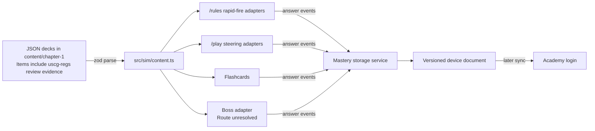
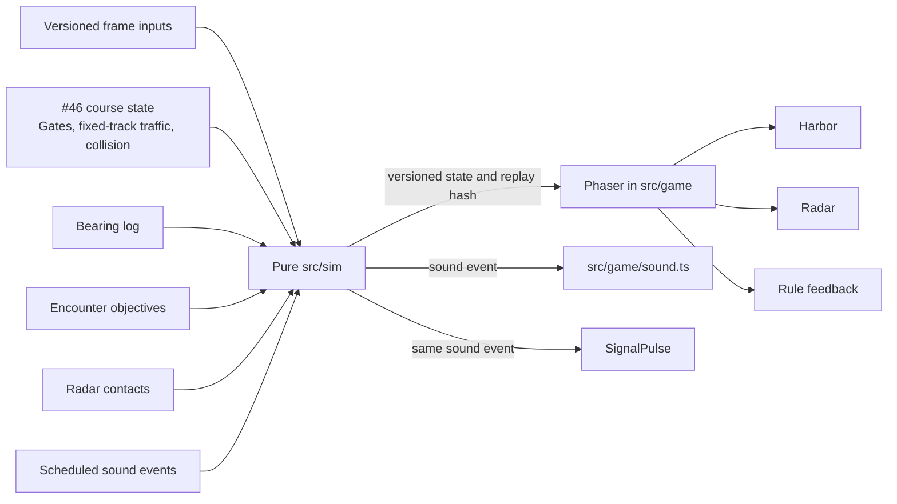

# Chapter 1 build plan

This plan covers Chapter 1, Rules of the Road. It does not authorize application work. Et remains the only merge authority.

## Sources and fixed point

This plan read `main` at commit `86aabcf8422c932f159b507dda7f329a541d8449` on 2026-10-22.

It also read these unmerged branch heads:

- `head-dev/harbor-traffic-course` at `7df4aec`, associated with issue #46
- `head-dev/ch1-definitions` at `3c67dd4`, associated with issue #47

GitHub had no pull request numbered 46 or 47 when this plan was written. Those numbers identify open issues. The branch contents were available and were read directly.

The plan also uses issue #45, the Rules of the Road prototype gallery, the 2026-10-22 Night Harbor Run regulation check, ADR 0001 and `docs/product/DECISIONS.md`. Prototype and issue text supplied design evidence only. It did not override settled decisions.

## Status key

- **Decided** means `DECISIONS.md` or accepted ADR 0001 settles the choice.
- **Proposed** means an ADR in this pull request describes a choice that Et has not accepted.
- **Open** means implementation must wait for Et or the named specialist.

| Choice | Status | Authority |
| --- | --- | --- |
| Strict TypeScript, Phaser 4.2.1, Vite, pure deterministic `src/sim` | Decided | G1 and ADR 0001 |
| Chapter order and rapid-fire or steering orientation | Decided | G7 and G8 |
| Both rule sets in Chapter 1 and a visible rule-set chip | Decided | G6 |
| Three hearts, miss replay, stars and unlock thresholds | Decided | G11 and G12 |
| Shared mastery between the game and flashcards | Decided | G9 |
| Timed multiple-choice exam boss and two passing runs | Decided unless Et changes it | G10 and G10a |
| Validated content files and review evidence | Proposed | ADR 0002 |
| One rapid-fire run state machine | Proposed | ADR 0003 |
| One integer Rule 21 visibility module | Proposed | ADR 0004 |
| Versioned rule-and-situation mastery keys | Proposed | ADR 0005 |
| One level registry for `/rules` and `/play` | Proposed | ADR 0006 |
| Composed steering systems on #46 | Proposed | ADR 0007 |
| Shared interface palette and signal pulse | Proposed | ADR 0008 |
| Night Harbor Run's place relative to the G10 boss | Open | Et |
| The player-facing shape of Inland and International variants | Open | Et |

## Smallest build path

1. Integrate #46 and #47 in the order described under [Merge order](#merge-order-for-46-and-47).
2. In the Definitions ticket, migrate #47's deck and mastery data before adding another deck. Extract its shared rapid-fire scene flow instead of copying `DefinitionsScene`.
3. Build the Lights level next. It supplies the Rule 21 module needed by flashcards and any Night Harbor Run port.
4. Add day shapes and Rule 18 as view and input adapters over the same rapid-fire state machine.
5. Add the pure horn hold evaluator for level 4. Audio remains an output.
6. Reuse #46's course, traffic and helm for levels 6 to 8. Add only the lesson state each level needs.
7. Do not implement a boss form or an Inland variant until Et answers the open questions.

## Content model

ADR 0002 proposes JSON files under `content/chapter-1/`, parsed by zod in `src/sim/content.ts`. The following TypeScript shape records the contract. It is a design, not code in this pull request.

```ts
type RuleSet = 'both' | 'inland' | 'international';
type ContentKind = 'card' | 'situation' | 'question';
type ISODate = string; // The zod schema uses z.string().date().

type RuleCitation = {
  authority: 'colregs' | '33-cfr-83' | 'both' | 'annex-i';
  rule: string;
  paragraph: `(${string})`;
};

type DraftReview = {
  status: 'draft';
};

type CheckedReview = {
  status: 'checked';
  reviewer: 'uscg-regs';
  checkedOn: ISODate;
  sourceTitle: string;
  sourceEdition: string;
  checkedCitations: [RuleCitation, ...RuleCitation[]];
};

type Review = DraftReview | CheckedReview;

type AnswerOption = {
  optionId: string;
  label: string;
  artRef?: string;
};

type BaseContentItem = {
  situationId: string;
  kind: ContentKind;
  artRef: string;
  cue: string;
  explanation: string;
  spokenPhrase: string;
  citations: [RuleCitation, ...RuleCitation[]];
  masteryObjectives: [
    { ruleKey: string; citation: RuleCitation },
    ...Array<{ ruleKey: string; citation: RuleCitation }>,
  ];
  ruleSet: RuleSet;
  review: Review;
};

type ChoiceContentItem = BaseContentItem & {
  interaction: 'choice' | 'flick-choice';
  answer: AnswerOption;
  distractors: [AnswerOption, AnswerOption, ...AnswerOption[]];
};

type TimedSignalContentItem = BaseContentItem & {
  interaction: 'timed-signal';
  answer: {
    optionId: string;
    label: string;
    pattern: string;
  };
  distractors: [];
};

type ContentItem = ChoiceContentItem | TimedSignalContentItem;

type Deck = {
  schemaVersion: 1;
  deckId: string;
  levelId: string;
  items: [ContentItem, ...ContentItem[]];
};
```

Zod checks this data during normal verification and before a scene starts. The checks cover nonempty and unique IDs, valid calendar dates, distinct answer and distractor option IDs, resolved art references, paragraph-level citations, rule-set values and the review union. Choice interactions require at least two real distractors. Timed-signal interactions require an answer pattern and an empty distractor list because the player performs the answer. Annex I may add a citation but cannot replace the item's applicable rule paragraph. The checked citation list must cover every item citation. A `checked` item without `uscg-regs`, a date and source evidence cannot parse. A content test also rejects an answer repeated among its distractors.

The `masteryObjectives` list separates rules the player is tested on from citations that only support an explanation. This prevents a Rules 15 and 16 explanation from granting mastery for both when the question tested only Rule 15.

The diagram shows the same content and mastery flow described above. Review evidence stays inside each JSON content item.



## Rapid-fire engine

The scoring core in `src/sim/rapid.ts` on branch #47 generalizes to levels 2, 3 and 5. Its shuffled queue, combo, hearts, miss return and star calculation do not depend on Definitions.

It does not generalize as-is to all four later rapid-fire levels. Before level 2, the implementation needs these changes:

- Rename card-specific terms to situation terms.
- Add versioned replay inputs, serializable state and a trace hash.
- Extract question, feedback, miss replay and end-screen flow from `DefinitionsScene`.
- Let a level adapter provide choices, art and input mapping.
- Keep answer evaluation outside the run state machine.

| Level | Existing run state | New adapter or evaluator |
| --- | --- | --- |
| Lights | Reuse | Bridge-view art and choice adapter |
| Day shapes | Reuse | Day-shape art and choice adapter |
| Horn signals | Reuse after evaluation | Pure press-and-release frame evaluator and blast-pattern renderer |
| Rule 18 | Reuse | Two-vessel art and flick adapter |

The horn evaluator records press and release frame IDs. It grades short and prolonged blasts against checked duration ranges, then sends a right or wrong result to `rapid.ts`. `AudioContext.currentTime` never grades an answer.

## Rule 21 visibility

ADR 0004 proposes `src/sim/navigation-lights.ts` as the only visibility calculation used by the Lights level, Night Harbor Run and flashcards.

Inputs:

- vessel heading in 1,024 units per turn
- observer bearing in the same units
- light IDs and kinds: masthead, port sidelight, starboard sidelight, stern, towing or all-round
- a separately reviewed forward cutoff for sidelights when Annex I applies

Outputs:

- normalized relative aspect
- stable IDs of visible lights

The existing turn representation makes the main boundaries exact. A 112.5 degree sector is 320 units and a 67.5 degree half-sector is 192 units. Integer normalization and comparisons avoid floating-point edge errors. Half-open sectors give an exact aft boundary to the stern or towing sector. The masthead and sidelight sectors stop one unit before it. `uscg-regs` must check that endpoint convention against the primary text before ADR 0004 can become accepted.

Unit tests cover each boundary at one unit inside, exactly on and one unit outside. They also cover wraparound, port and starboard mirroring, rotational invariance, all-round lights and fixed flashcard aspects.

Golden replays pin:

- every Lights-level sector transition in both directions
- Night Harbor Run's head-on, crossing-from-starboard and overtaking gates
- the visible light IDs, not pixel colors alone

## Mastery record

G9 requires a record for a rule and a situation, not merely a card. ADR 0005 proposes this key:

```text
chapter-1/<both|inland|international>/rule-<number>-<paragraph-parts>/<situation-id>
```

Rule keys use lowercase ASCII. Parentheses are removed and nested paragraph parts are joined with hyphens. Rule 3(b) becomes `rule-3-b`, and Rule 17(a)(ii) becomes `rule-17-a-ii`. Content validation rejects any other encoding. A situation ID uses the existing lowercase ID unchanged and cannot contain `/`.

Device storage uses `captains-academy:mastery:v2` with a zod-checked document:

```ts
type MasteryRecordV2 = {
  schemaVersion: 2;
  masteryKey: string;
  ruleKey: string;
  situationId: string;
  ruleSet: 'both' | 'inland' | 'international';
  correct: number;
  incorrect: number;
  currentStreak: number;
  reviewStep: number;
  lastAnsweredAt: string | null;
  nextReviewAt: string | null;
  revision: number;
  deviceId: string;
  legacyImport?: {
    right: number;
    wrong: number;
    streak: number;
  };
};
```

The game and flashcards send answer events to one storage service. The source is `game` or `flashcards`. Device-first storage is required now by G4. Academy-login sync comes later under the same stable key. The server conflict policy remains a separate design task before sync work starts.

Migration from #47:

1. Preserve each #47 card ID exactly as the new Definitions `situationId`. For example, `rule3:motorboat` stays `rule3:motorboat`.
2. Load the parsed Definitions deck to get the known situation and canonical rule keys.
3. Read each `captains-academy:mastery:<card-id>` value.
4. Accept only non-negative integer `right`, `wrong` and `streak` values.
5. Build every corresponding version 2 record in memory and retain the old aggregate in `legacyImport`.
6. Replace the complete version 2 document with one local-storage write. That single document write is the migration boundary.
7. Mark migration complete only inside that document. Keep the old keys for one release and delete them only in a later versioned migration.
8. If parsing or the document write fails, leave the prior version 2 document and every old key untouched, then retry later.

The migration must not invent dates or answer order. #47 did not store them.

## Level registry and chapter map

ADR 0006 proposes one registry consumed by both route shells and the chapter map.

| Order | Level ID | Mode | Route | Stars and unlock |
| --- | --- | --- | --- | --- |
| 1 | `ch1-definitions` | Rapid-fire | `/rules` | Open first |
| 2 | `ch1-lights` | Rapid-fire | `/rules` | One star on level 1 |
| 3 | `ch1-day-shapes` | Rapid-fire | `/rules` | One star on level 2 |
| 4 | `ch1-horn-signals` | Rapid-fire | `/rules` | One star on level 3 |
| 5 | `ch1-rule-18` | Rapid-fire | `/rules` | One star on level 4 |
| 6 | `ch1-steady-bearing` | Steering | `/play` | One star on level 5 |
| 7 | `ch1-give-way` | Steering | `/play` | One star on level 6 |
| 8 | `ch1-fog-narrow-channels` | Steering | `/play` | One star on level 7 |
| 9 | `ch1-boss` | Pending | Pending | Two stars on levels 1 to 8 |

Each entry has its supported rule sets and the active run's rule-set chip. Shared content displays `Both`. An Inland-only or International-only situation displays that set. The exact selector or separate-variant flow is open.

A discriminated registry entry is either `active`, with a route and content or mission adapter, or `pending`, with a blocking decision and no adapter. Only the boss may be pending. Integrity tests require every active entry to resolve and require a pending entry not to claim a route or content ID. The chapter map shows the pending boss as locked, so it cannot be selected before Et's decision.

A Chapter 1 completion result supplies cleared state, semantic misses, elapsed frames and par frames. Its star policy follows G12: three stars for no misses inside par, two for one miss and one for any clear. #46's docking-specific bump policy remains with the docking prototype and does not become Chapter 1's star policy.

A new level plugs in by adding parsed content or a mission, a scene adapter, one registry entry, unit and golden tests, end-to-end coverage and a verification-skill feature. It does not add another unlock implementation.

## Steering levels

Branch #46 supplies the parts levels 6 to 8 should reuse:

- the mission gate schema and ordered gate state
- fixed-track traffic and start triggers
- integer hull contacts and collision outcomes
- the compiled mission and 60 Hz simulation
- twin-lever touch and keyboard helm controls
- replay hashing and course golden replays

The branch is not yet a complete Chapter 1 steering engine. ADR 0007 proposes these additions:

| Level | New pure state | Renderer reads |
| --- | --- | --- |
| 6, Steady bearing | Quantized relative-bearing samples, closing range and mission tolerance | Bearing log and encounter feedback |
| 7, Who gives way | Encounter role, expected action, success region and rule-set content ID | Traffic, role cue and miss replay |
| 8, Fog and narrow channels | Radar contacts, scheduled sound events, visibility mode and channel objective | Radar, hidden world art, signal pulse and channel marks |

Every input is a versioned frame input. Each subsystem contributes to the replay hash. Phaser, Web Audio and wall-clock time do not decide outcomes.

The diagram draws only those stated steering relationships.



Level 6 gets a success replay and a constant-bearing miss. Level 7 gets correct and canonical wrong replays for overtaking, head-on and crossing. Level 8 gets a narrow-channel success, a radar-only fog success and an unsafe-speed or wrong-turn miss.

## Shared sound and color rules

G15 and G16 are settled:

- Interface components do not use red or green. Those colors remain available only to authentic navigation-world art, such as vessel lights and navigation aids.
- Gold and electric blue mark wins. Purple or white mark misses.
- Every sound signal has a visible pulse.

ADR 0008 proposes a typed interface palette and one `SignalPulse` component under `src/game/ui/`. The simulation emits a signal ID and start and end frames. `src/game/sound.ts` and `SignalPulse` consume that same event. Muting audio cannot remove the pulse or change grading. Reduced-motion mode shows a static high-contrast pulse and a text label.

Tests render every signal with audio disabled. Import-boundary and palette tests reject interface red or green outside navigation-world art. Image review still checks colors baked into art.

## Boss options

Et must choose. This plan does not select an option.

### Option 1: Night Harbor Run replaces the G10 exam boss

This changes settled G10. `DECISIONS.md` and the boss acceptance tests would need an explicit amendment. The course would have to preserve the two-run 90 percent requirement or Et would have to replace that requirement too. The current prototype needs all nine must-fix regulation items, paragraph-level review, deterministic Phaser systems and new mobile proof. This has the highest rule-content and simulation cost.

### Option 2: Night Harbor Run runs alongside the G10 exam boss

The timed multiple-choice boss remains the chapter-clear gate. Night Harbor Run becomes a separate chapter challenge or practice course. This preserves exam-format coverage and reuses the Rule 21, steering, radar and sound systems. It adds a second large chapter activity, a registry position, its own stars or rewards, and a clear explanation that it does not replace the exam boss.

### Option 3: Night Harbor Run becomes a later level

Chapter 1 ships with the G10 exam boss. Night Harbor Run waits until levels 2 and 6 to 8 have proved the shared systems and the regulation check has primary sources. This has the lowest immediate cost and the least throwaway code. It defers the prototype's combined course and requires a later content and playtest pass.

Under the current decisions, only options 2 and 3 can proceed without changing G10.

## Inland and International delivery

G6 already decides that Chapter 1 covers both rule sets. The open question is how a player enters and experiences a variant.

If Et wants variants now, a level run selects `inland` or `international`. Shared items marked `both` appear in either run. Variant items use the same situation ID when they test the same scene, with rule-set-specific answers, vessel specs, explanations, spoken phrases and citations. Each variant gets separate `uscg-regs` evidence, mastery keys and golden replays. The chapter map needs a selector and completion policy for the two runs.

The cost now is dual content review, selector design, registry rules, mastery display, tests and proof for both runs. Night Harbor Run also needs changed signals, pushing lights, pipeline lights, constrained-by-draft content and fog answers listed in the 2026-10-22 regulation check.

If Et wants variants later, build only checked shared content plus clearly tagged single-rule-set situations now. Keep stable situation IDs and explicit rule-set fields. Later work adds overlays or sibling items, a selector and second-set replays. This delays dual review, but later scene and progress tests must expand. It does not require changing mastery keys or the base content schema.

The plan does not choose between a selector, separate differences levels or a later Night Harbor Run variant.

## Build tickets

Each implementation ticket follows the same handoff. `uscg-regs` checks the named content against primary text before the answer key is treated as ready. `ux-ui` owns the interaction, orientation, accessibility and hardest-user test. `head-dev` implements the checked plan. `test-agent` adds and runs the bounded tests. `code-reviewer` reviews the finished head without editing it. `git-integrator` checks branch ancestry, conflict resolution, proof and merge order. Et alone merges.

### Ticket 1: Definitions and lookout

Scope:

- Integrate #47's Definitions level.
- Add the settled lookout part of G7 or wait if Et changes G7.
- Migrate the Definitions deck to ADR 0002.
- Extract shared rapid-fire scene flow.
- Migrate per-card mastery to ADR 0005.
- Register the level and its rule-set chip.

Modules touched:

- `content/chapter-1/definitions.json`
- proposed `src/sim/content.ts`
- `src/sim/rapid.ts`
- `src/game/rapid/`
- proposed `src/game/levelRegistry.ts`
- `src/game/storage.ts`
- `/rules`
- verification-skill Definitions feature

Tests:

- deck schema and art resolution
- deterministic shuffle, hearts, miss return, stars and rapid golden replay
- mastery migration, malformed old data and interrupted write
- clean run, miss replay, out of hearts, keyboard and one-thumb portrait play
- level 2 remains locked without one star

`uscg-regs` first checks every Rule 3 paragraph, the Rule 5 lookout material, answer, distractor, explanation and spoken phrase. Branch #47's 17 cards are not signed off.

Roles: `uscg-regs` checks content; `ux-ui` checks the extracted portrait flow and lookout interaction; `head-dev` integrates and migrates; `test-agent` covers the deck, run and migration; `code-reviewer` reviews the complete ticket; `git-integrator` prepares it for Et.

### Ticket 2: Lights

Scope:

- Build the bridge-view rapid-fire adapter.
- Build the pure Rule 21 module from ADR 0004.
- Move the checked lights deck into the common content model.
- Share the module with fixed-aspect flashcard tests and expose it for a later Night Harbor Run port.

Modules touched:

- `content/chapter-1/lights.json`
- `src/sim/content.ts`
- proposed `src/sim/navigation-lights.ts`
- `src/sim/rapid.ts`
- `src/game/rapid/`
- navigation-light art
- level registry and `/rules`

Tests:

- all Rule 21 integer sector boundaries
- mirror and rotation properties
- deck and art references
- rapid golden replay across sector edges
- clean, missed and muted portrait runs

`uscg-regs` first checks Rules 20, 21 and each applicable paragraph in Rules 23 to 31, plus Annex I cutoff behavior. The 2026-10-22 check is not sign-off because it could not read primary text.

Roles: `uscg-regs` checks sectors and deck content; `ux-ui` owns bridge-view readability without using interface red or green; `head-dev` builds the module and adapter; `test-agent` pins boundaries and replays; `code-reviewer` reviews shared use; `git-integrator` prepares it for Et.

### Ticket 3: Day shapes

Scope:

- Add the day-shape deck and art adapter over the rapid-fire engine.
- Keep daytime shapes separate from the Lights renderer.
- Reuse content review, mastery, stars and chapter-map behavior.

Modules touched:

- `content/chapter-1/day-shapes.json`
- day-shape art under `src/game/rapid/`
- level registry and `/rules`
- mastery storage and verification feature

Tests:

- deck schema, unique shape combinations and art resolution
- clean and missed rapid golden replays
- one-thumb and keyboard input
- rule-set chip and level 4 unlock

`uscg-regs` first checks Rule 20 and every shape paragraph used from Rules 25 to 30. It checks that a shape does not imply lights disappear by day.

Roles: `uscg-regs` checks each shape; `ux-ui` checks silhouette recognition and labels; `head-dev` adds only the adapter and deck; `test-agent` covers content and play; `code-reviewer` checks reuse; `git-integrator` prepares it for Et.

### Ticket 4: Horn signals

Scope:

- Add hold-to-sound play with real short and prolonged durations.
- Add the pure frame evaluator and a blast-pattern adapter.
- Use one simulation event for audio and the visual pulse.
- Keep the level playable muted.

Modules touched:

- `content/chapter-1/horn-signals.json`
- proposed horn evaluator under `src/sim`
- `src/sim/rapid.ts`
- `src/game/sound.ts`
- proposed `src/game/ui/SignalPulse.ts`
- rapid adapter, registry and `/rules`

Tests:

- press and release at each duration boundary
- multi-blast gaps and patterns
- deterministic replay independent of Web Audio
- pulse with audio enabled, muted and unavailable
- reduced-motion pulse and keyboard input

`uscg-regs` first checks Rule 32 blast definitions and every signal paragraph used from Rules 34 and 35. The prior direct check verified about 1 second for short and 4 to 6 seconds for prolonged; each actual pattern still needs review.

Roles: `uscg-regs` checks timing and meaning; `ux-ui` owns hold feedback, pulse and muted play; `head-dev` builds the evaluator and adapters; `test-agent` tests frame edges and accessibility; `code-reviewer` checks audio cannot grade answers; `git-integrator` prepares it for Et.

### Ticket 5: Pecking order, Rule 18

Scope:

- Show two vessels and let the player flick the give-way vessel.
- Reuse the rapid run state and shared content.
- Include rule-set and situational exceptions rather than teaching an absolute rank.

Modules touched:

- `content/chapter-1/rule-18.json`
- two-vessel art and flick adapter under `src/game/rapid/`
- registry, `/rules` and mastery storage

Tests:

- flick direction and keyboard equivalent
- pair ordering does not reveal the answer
- clean and missed golden replays
- exceptions and rule-set tags parse
- level 6 unlock

`uscg-regs` first checks every Rule 18 paragraph and the Rules 9, 10 and 13 exceptions used by a situation. It resolves the rowboat and seaplane questions from the Night Harbor Run check before those situations appear.

Roles: `uscg-regs` checks ranking and exceptions; `ux-ui` owns the one-thumb flick and non-color cues; `head-dev` adds the adapter; `test-agent` covers pair order and gestures; `code-reviewer` checks against absolute-rank wording; `git-integrator` prepares it for Et.

### Ticket 6: Steady bearing, Rule 7

Scope:

- Reuse #46's helm, course and traffic.
- Add the pure bearing log and closing-range lesson.
- Grade an early safe action with a short replay after a miss.

Modules touched:

- a level 6 mission
- #46's `src/sim/course.ts`, mission schema and simulation
- proposed bearing-log state under `src/sim`
- `src/game/HarborScene.ts`
- registry, `/play` and mastery storage

Tests:

- quantized bearing samples, wraparound and mission tolerance
- closing range with steady and changing bearings
- success and constant-bearing miss golden replays
- landscape touch and desktop helm

`uscg-regs` first checks Rule 7 paragraph by paragraph and any Rule 8 action used in feedback. It checks that steady bearing is taught as risk evidence, not an infallible test.

Roles: `uscg-regs` checks the lesson; `ux-ui` owns the readable bearing log and helm load; `head-dev` composes the bearing state with #46; `test-agent` pins the math and replays; `code-reviewer` checks deterministic state; `git-integrator` prepares it for Et.

### Ticket 7: Who gives way, Rules 13 to 17

Scope:

- Reuse fixed-track traffic for overtaking, head-on and crossing.
- Add encounter role, expected action and success region.
- Show the five-second right-action replay after a miss.

Modules touched:

- a level 7 mission and checked situations
- #46 course, traffic, collision and helm code
- proposed encounter-objective state under `src/sim`
- `HarborScene`, registry, `/play` and mastery storage

Tests:

- Rules 13 to 17 encounter classification
- deterministic timing and success regions
- correct and wrong golden replay for each encounter type
- stand-on intervention stages and no forbidden shortcut wording

`uscg-regs` first checks every used paragraph in Rules 13 to 17. The Rule 17 distinction between "may act" and "shall act" must match the primary text.

Roles: `uscg-regs` checks roles and intervention stages; `ux-ui` checks cues and replays under helm load; `head-dev` adds encounter objectives; `test-agent` covers every role; `code-reviewer` checks content and sim separation; `git-integrator` prepares it for Et.

### Ticket 8: Fog and narrow channels

Scope:

- Reuse channel gates and traffic.
- Add radar contacts, scheduled fog signals and sound-only encounters.
- Hide vessel art in fog while retaining radar and the required visual signal pulse.
- Include Rule 10 under the current G7. Remove it only if Et changes that settled decision.

Modules touched:

- a level 8 mission and checked situations
- #46 course and traffic
- proposed radar and scheduled-signal state under `src/sim`
- `src/game/sound.ts`, `SignalPulse`, `HarborScene`, registry and `/play`

Tests:

- radar contact determinism and hidden world art
- fog signal schedules and visible pulses
- narrow-channel gate objectives
- success and unsafe-speed or wrong-turn golden replays
- muted, deaf-accessible and reduced-motion play

`uscg-regs` first checks every used paragraph in Rules 9, 10, 19 and 35. It resolves the Rule 19 radar-versus-heard-signal distinction found in the 2026-10-22 report.

Roles: `uscg-regs` checks channel and fog content; `ux-ui` owns radar, pulse and no-audio comprehension; `head-dev` composes radar and signal state; `test-agent` covers visibility, timing and replays; `code-reviewer` checks no renderer-owned outcome; `git-integrator` prepares it for Et.

### Ticket 9: Chapter boss

Scope:

- Wait for Et's Night Harbor Run decision.
- If G10 remains, build original timed questions from checked official rule text, require 90 percent on two separate runs and require two stars on levels 1 to 8.
- Do not copy Coast Guard sample-exam questions.
- Do not build the OUPV boss until G10a's NMC confirmation and Coast Guard reviewer conditions are met.

Modules touched:

- a boss content file under `content/chapter-1/`
- a boss adapter and route chosen after Et's decision
- registry, chapter progress and mastery storage
- Night Harbor Run systems only if Et chooses option 1 or 2

Tests:

- original-question source and paragraph citations
- timer and scoring boundaries
- two separate passing runs
- boss lock until all eight levels have two stars
- no copied sample-exam text
- selected Night Harbor Run tests if that option applies

`uscg-regs` first checks every question, distractor, explanation and spoken phrase against current official text. G10a's external confirmations remain blockers.

Roles: `uscg-regs` checks every question and source; `ux-ui` owns timed-exam clarity and any course placement; `head-dev` implements only the selected option; `test-agent` covers score, lock and source rules; `code-reviewer` checks G10 and G10a; `git-integrator` prepares it for Et.

## Merge order for #46 and #47

Recommended order:

1. `uscg-regs` checks #46's four traffic lessons against primary text, including Rules 5, 6, 9, 14 and 15. #46 does not proceed to Et with draft rule content.
2. The Git Integration Agent rebases `head-dev/harbor-traffic-course` onto current `main`, reruns verification, regenerates proof and prepares #46 for Et.
3. After Et merges #46, the Git Integration Agent rebases `head-dev/ch1-definitions` onto the new `main`, merges the verification-skill features by hand, reruns verification, regenerates proof and prepares #47 for Et.
4. Chapter 1 ticket work starts from the merged #47 head.

#46 goes first because its verification-driver change is small and `/play`-specific. #47 makes the broader driver change that supports both `/play` and `/rules`, so the second integration can retain that generalization while adding #46's course recipe.

Both branches edit:

- `.claude/skills/verify-captains-academy/SKILL.md`
- `.claude/skills/verify-captains-academy/drive.mjs`
- `.claude/skills/verify-captains-academy/features/README.md`
- `proof/manifest.json`
- `proof/verification.txt`

The skill conflict is semantic, not a choose-one conflict. The result must retain #46's harbor-course feature, steps and shorter `LEVER_HALF = 135`, plus #47's route-aware open step, dynamic canvas coordinates, Definitions answers and `/rules` state. The final feature index lists both.

Proof files cannot be combined. Regenerate one proof bundle from the integrated head after all conflict edits. The Git Integration Agent owns the mechanics, and Et performs each merge.

## Questions for Et

1. Does Night Harbor Run replace the G10 exam boss, run alongside it, or become a later level?
2. How should players enter Inland and International content: a per-level selector, separate differences levels, or variants added after the shared content?
3. Does Et confirm Chapter 1 implementation now despite A3 and G19 placing the sea-time log before the full game?
4. G7 says level 1 is "definitions and lookout", while #47 implements Definitions only. Should lookout join ticket 1, or should G7 change?
5. G7 includes Rule 10 in level 8. The requested shorthand names Rules 9 and 19. Should ticket 8 include Rule 10, or should G7 change?
6. Is Chapter 1 for license candidates only, or also Coast Guard Academy cadets? Issue #45 leaves this open.
7. Should the mixed-review stops proposed in the prototype gallery exist? This plan does not add them.
8. Should Chapter 1 completion unlock later chapters in the pattern proposed by the gallery? This plan does not define cross-chapter unlocks.
9. Who is the Coast Guard reviewer required by G10a? This must be named before launch, and G10a blocks the OUPV boss before then.
10. Should the existing #46 and #47 branch heads be opened as implementation pull requests? GitHub currently has issues with those numbers, not pull requests.

The arcade-game name, pricing, approved-course strategy, league safety and the realistic Unity simulator remain parked in `DECISIONS.md`. This plan does not use any of them as a premise.

## Regulatory gates that are not Et decisions

- `uscg-regs` needs readable primary Inland and International rule text. The 2026-10-22 Night Harbor Run report is not sign-off.
- The NMC must confirm the exam counts, passing marks, module mappings and listed upgrade conditions before the OUPV boss, as G10a requires.
- The NMC questions on vessels under oars, seaplanes and optional second masthead lights remain open.
- Every implemented rule item needs paragraph-level checked evidence in the content file.

## Verification and exit criteria

Each ticket runs `bash scripts/verify.sh`, updates the verification feature map for player-visible behavior and commits a PASS proof bundle. Golden replay updates use the explicit update flag and receive review as behavior changes.

Chapter 1 is not complete until:

- every level has checked content and the selected rule-set presentation
- levels 1 to 8 obey the one-star unlock chain
- the selected boss obeys Et's decision and G10 or its explicit replacement
- the boss lock requires two stars on all eight levels
- the game and flashcards read the same mastery keys
- sound signals remain understandable while muted
- interface feedback uses no red or green
- deterministic unit tests and golden replays pass
