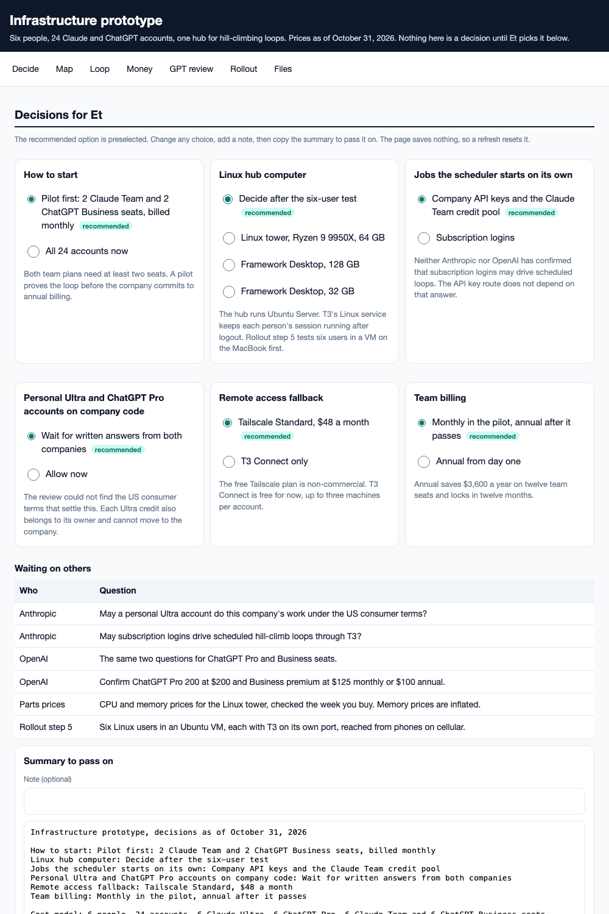

# Infrastructure prototype

The plan for the team's AI coding setup. Six people each have four accounts, 24 in all. The company pays for a Claude Team premium seat and a ChatGPT Business premium seat. Each person pays for a Claude Ultra account, the $200 tier formerly called Max 20x, and a ChatGPT Pro 200 account. One Linux hub, running Ubuntu Server, runs hill-climbing loops: it generates code variants in parallel, scores them with the same tests, and keeps a winner only if it beats the current best.

This is team tooling, not part of the academy app. It shares no code with the app. Nothing here is a decision until Et picks it on the infrastructure prototype page.



## Open it

Open [`playable/infrastructure-prototype.html`](playable/infrastructure-prototype.html) in a browser. GitHub shows its source, so download the file or check out the branch. The page has:

- six decisions with the recommended option preselected, and a button that copies a summary of your choices to pass on
- the infrastructure map and the hill-climbing loop
- a cost model where you set the number of people and each account type, then see up to 24 accounts split person by person, with monthly, per-person and year-1 totals
- the GPT review's findings and what changed because of them
- the seven-step rollout, and links to every file

## On the decision board

The app's decision board at `/prototypes/` lists the infrastructure map and the design, financials and GPT review PDFs on its Reference tab, under the feature Infrastructure. They are reference material, so nobody dots them. The interactive page is not in the app build. Open it from a checkout.

## Files

| File | What it holds |
| --- | --- |
| [`reports/01-infrastructure-design.pdf`](reports/01-infrastructure-design.pdf) | Map, loop, account roles, hardware, software, rollout with pass tests and rollbacks |
| [`reports/02-financials.pdf`](reports/02-financials.pdf) | Individual and team totals, four scenarios, year 1 for three hubs |
| [`reports/03-gpt-review-handoff.pdf`](reports/03-gpt-review-handoff.pdf) | What GPT checked, the prompt it got, and what changed after round 1 |
| [`reports/04-gpt-review.pdf`](reports/04-gpt-review.pdf) | GPT-6.1-Sol's full findings with sources, on the earlier 12-account Claude-only plan. The same text is in `gpt-review.md` |
| [`reports/financials.csv`](reports/financials.csv) | Every cost line. Monthly and annual Team rows are alternatives, so do not sum the whole column |
| [`PROMPT.md`](PROMPT.md) | Prompts for two prototypes: a hill-climb loop simulator and the six-user hub test |
| [`src/build.py`](src/build.py) | Every price and the code that builds the PDFs |
| [`src/page.py`](src/page.py) | Builds the infrastructure prototype page from the numbers in `build.py` |
| [`images/infrastructure-map.png`](images/infrastructure-map.png) | The map on its own, for the decision board. Re-render it after changing the map in `build.py` |

## The numbers

| | Individual (6 Ultra + 6 ChatGPT Pro) | Team (6 Claude Team + 6 ChatGPT Business) | Combined |
| --- | ---: | ---: | ---: |
| Per month, team seats billed annually | $2,400 | $1,200 | $3,600 |
| Per month, team seats billed monthly | $2,400 | $1,500 | $3,900 |
| Per year, team seats billed annually | $28,800 | $14,400 | $43,200 |
| Per year, team seats billed monthly | $28,800 | $18,000 | $46,800 |

By provider, with team seats billed annually, Claude and ChatGPT each cost $1,800 a month. That is $600 per person a month: $400 for the person's own two accounts and $200 for the company's two seats. Year 1 with the recommended Linux tower is $45,898, or $48,874 with the API reserve and Tailscale. Claude prices were read from claude.com/pricing on 31 October 2026. ChatGPT prices come from October 2026 pricing guides because OpenAI's page blocked automated reads, so confirm them before buying. The tower's CPU and memory prices come from October 2026 price trackers during a memory shortage, so check them the week you buy. Other parts, UPS, drive, network and backup are estimates.

## Still open

- Whether personal Ultra and ChatGPT Pro accounts may do company work. Ask Anthropic and OpenAI in writing.
- Whether subscription logins may drive scheduled loops through T3. Ask both companies in writing.
- The ChatGPT Pro and Business premium prices. Confirm them on chatgpt.com/pricing.
- Whether one Linux hub runs six T3 users at once. T3's Linux service keeps running after logout, which makes this likely. Prompt 2 in `PROMPT.md` tests it in a VM.
- Current CPU and memory prices for the Linux tower.

## Change a price

Edit `PRICES` or `HARDWARE` in `src/build.py`, then run:

```sh
python3 -I docs/prototypes/infrastructure/src/build.py
python3 -I docs/prototypes/infrastructure/src/page.py
```

`build.py` needs Google Chrome for the PDFs and pandoc for the GPT review PDF.
